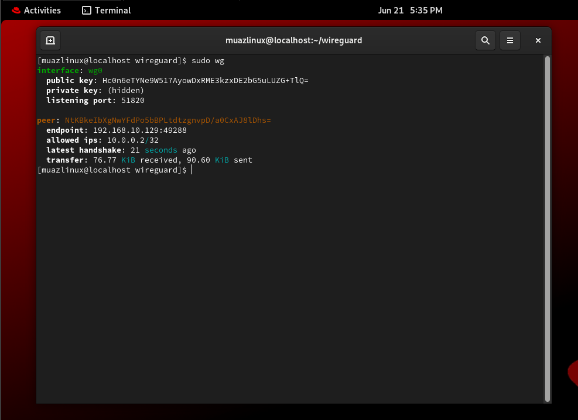
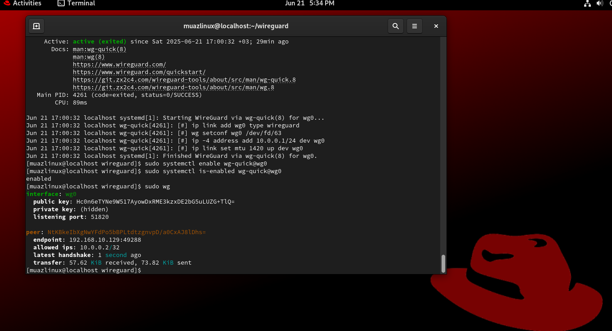
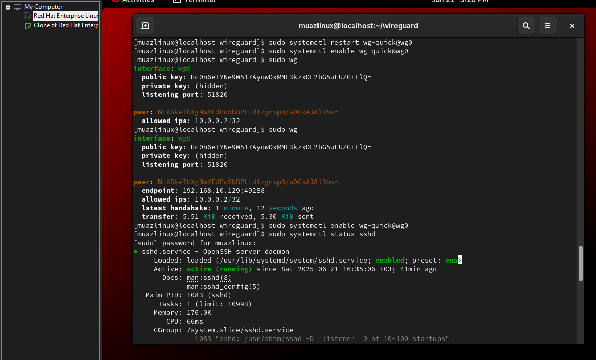
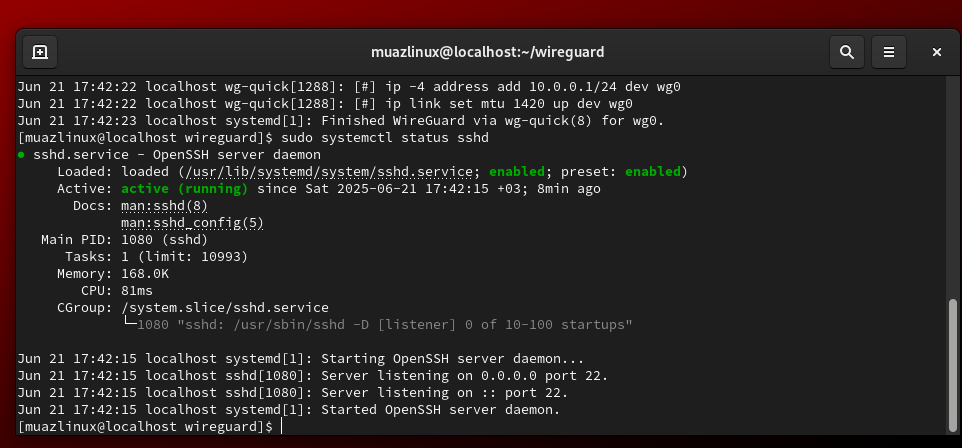
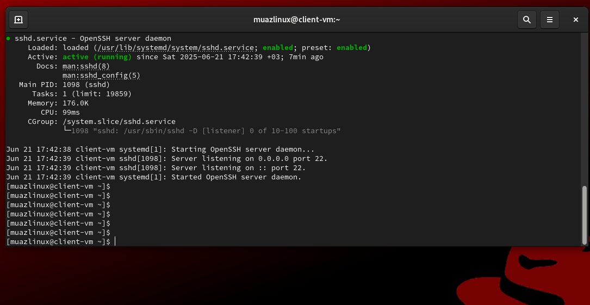

# Peer-to-Peer WireGuard VPN on RHEL

A hands-on lab in which I built an encrypted, peer-to-peer **WireGuard** VPN tunnel between two **Red Hat Enterprise Linux** virtual machines running in VMware, secured it with **firewalld**, and made it start automatically with **systemd**.



## Lab topology

```
   VMware (host-only / NAT network 192.168.10.0/24)

 ┌──────────────────────────┐        UDP 51820        ┌──────────────────────────┐
 │  RHEL server (localhost) │ ◄─────────────────────► │  RHEL client (client-vm) │
 │  LAN : 192.168.10.128    │   encrypted WireGuard   │  LAN : 192.168.10.129    │
 │  wg0 : 10.0.0.1/24       │         tunnel          │  wg0 : 10.0.0.2          │
 └──────────────────────────┘                         └──────────────────────────┘
```

| Item | Value |
|---|---|
| OS | Red Hat Enterprise Linux (2 VMs; the client is a clone of the server) |
| Hypervisor | VMware |
| VPN | WireGuard (`wireguard-tools`, `wg-quick`) |
| Tunnel subnet | 10.0.0.0/24 (server 10.0.0.1, client 10.0.0.2) |
| Listen port | UDP 51820 |
| Firewall | firewalld, custom zone `webzone`, masquerading |
| Service | `wg-quick@wg0` (systemd), enabled at boot |

## What I did

1. **Installed WireGuard** on both VMs with `dnf`.
2. **Generated key pairs** (`wg genkey | wg pubkey`) on each VM and exchanged only the public keys.
3. **Wrote `/etc/wireguard/wg0.conf`** on each side: interface address, listen port, private key, and the peer's public key / allowed IPs / endpoint. See [`configs/`](configs/).
4. **Enabled IP forwarding** (`net.ipv4.ip_forward = 1`) on the server.
5. **Configured firewalld**: created the custom zone `webzone`, opened UDP 51820 and enabled masquerading.
6. **Brought the tunnel up** with `wg-quick` and **enabled `wg-quick@wg0`** so it starts at boot.
7. **Verified** with `wg show` (latest handshake + transfer counters), `ping` across the tunnel, and SSH between the VMs (`sshd` active on both).

Full step-by-step commands: [`scripts/server-setup.sh`](scripts/server-setup.sh) and [`scripts/client-setup.sh`](scripts/client-setup.sh).

## Verification

**Service started and enabled at boot** – `wg-quick` creates `wg0`, assigns `10.0.0.1/24`, sets MTU 1420; `systemctl is-enabled` returns `enabled`; `wg` shows the peer `192.168.10.129` with a handshake 1 second ago:



**First handshake after restart** – before traffic the peer shows only `allowed ips`; after the client connects it shows its endpoint, latest handshake and data transferred:



**SSH available on both VMs** for management over the tunnel:

| Server | Client (`client-vm`) |
|---|---|
|  |  |

## Real-world uses

- Secure remote access for staff to an office or cloud network
- Site-to-site links between branches or between on-premises and cloud
- Encrypting management traffic (SSH, monitoring) between servers
- A lightweight, fast alternative to IPsec/OpenVPN

## What I learned

- Public-key based peer authentication and why private keys never leave the host
- Linux routing and IP forwarding for VPN traffic
- firewalld zones, ports and masquerading (NAT)
- Managing services with systemd and reading their logs
- Troubleshooting with `wg show`, `ip a`, `ping` and `journalctl`

## Repository contents

```
configs/   wg0.conf templates for server and client (placeholder keys)
scripts/   step-by-step setup commands for server and client
docs/      screenshots from the lab
```

> **Security note:** the configs in this repo are templates with placeholder keys. Real private keys are never committed (see `.gitignore`). The screenshots show only public keys; WireGuard always prints the private key as `(hidden)`.

## Author

**Muaz Naveed** – [GitHub](https://github.com/muaz-405) · [LinkedIn](https://linkedin.com/in/muaz-naveed-8754211ab)
